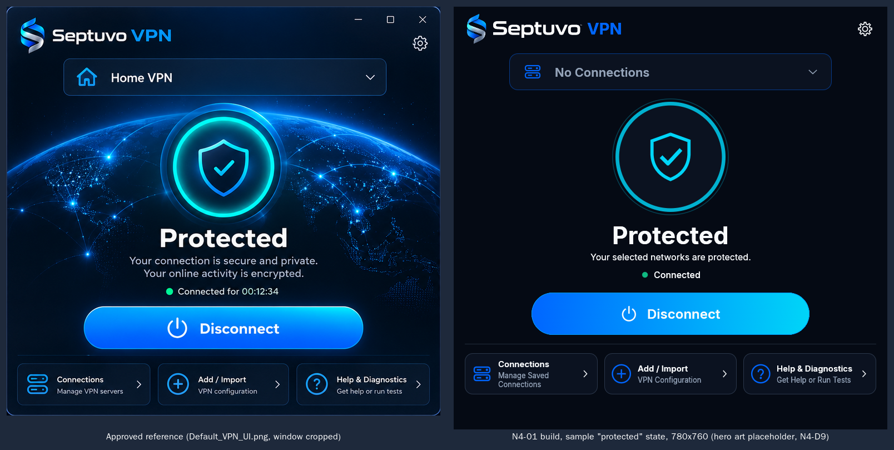
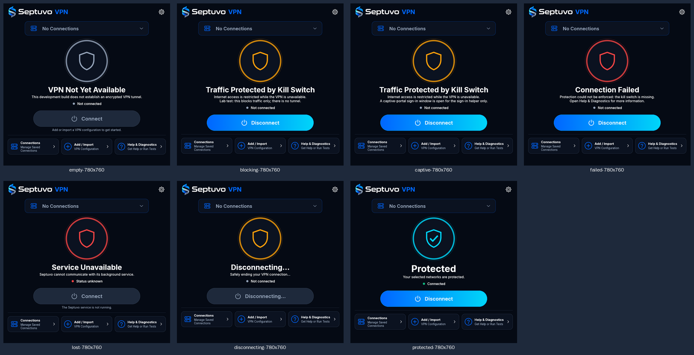
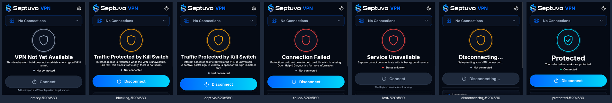
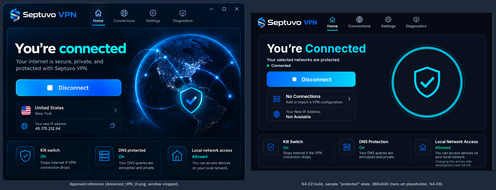
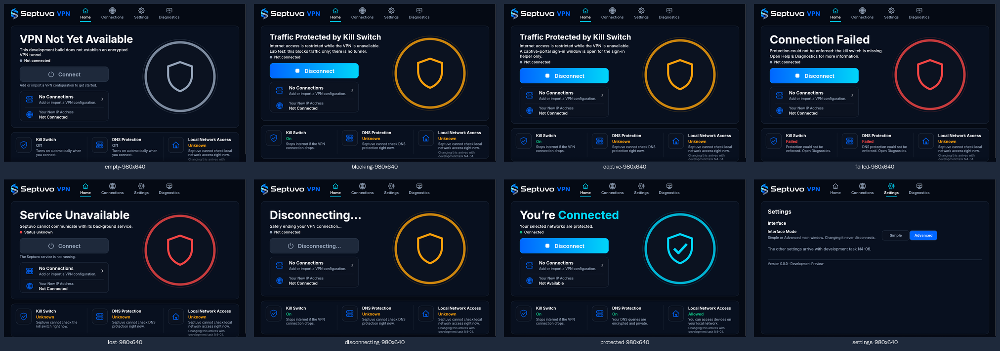
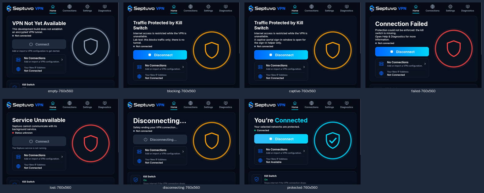
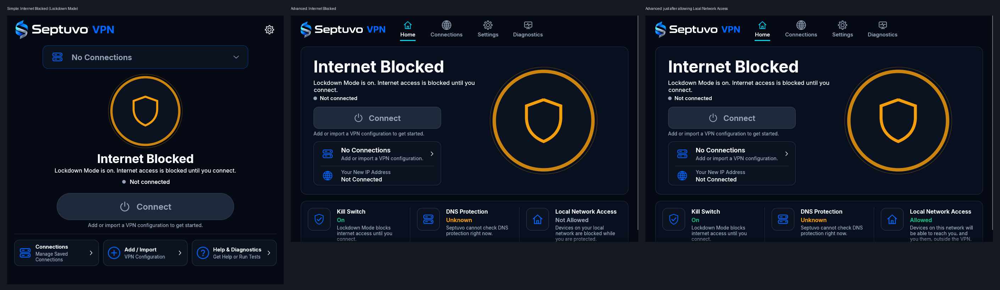
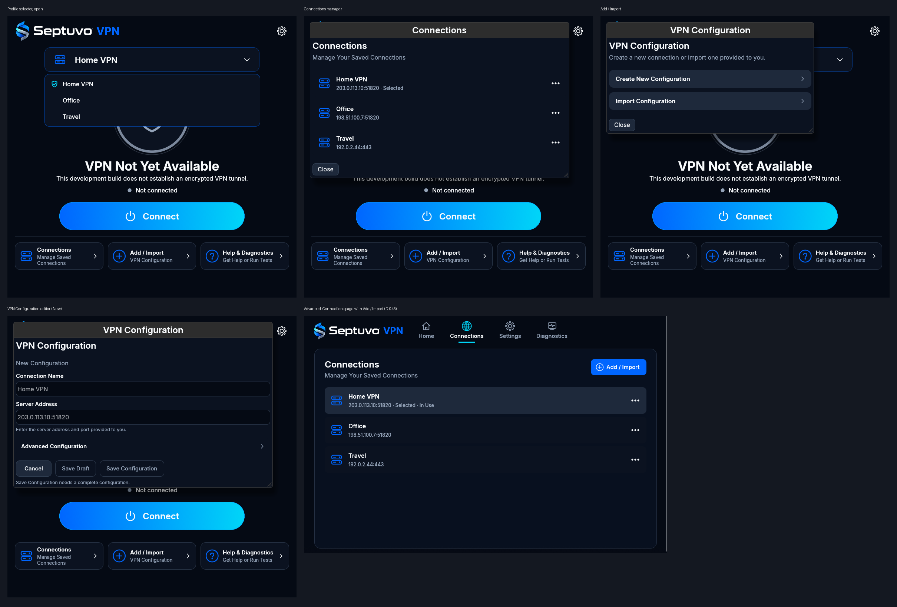

# Septuvo VPN desktop app (Linux, N4)

**Development preview.** The app creates no tunnel and has no cryptography before the G1 security review. It is an unprivileged viewer and remote control for the `septuvod` service, which stays lab-only (N3-01).

- **Code:** `desktop/`, a separate Cargo workspace (N4-D4), PolyForm Noncommercial 1.0.0 (N4-D5).
- **Language:** all Septuvo-authored code is Rust (D-005).
- **Toolkit:** egui/eframe 0.36.2 with the OpenGL (glow) renderer and AccessKit screen-reader support (N4-D1).
- **Dependencies:** reviewed in [dependency-review-desktop.md](../reviews/dependency-review-desktop.md), pinned in `desktop/Cargo.lock`, and checked in CI by the native-code gate.

## What N4-01 delivers

The **Simple main window** of the approved design ([DEFAULT-UI.md](../ui/desktop/DEFAULT-UI.md), `Default_VPN_UI.png`; D-037), connected to the real service.

| Part | Where | Notes |
| --- | --- | --- |
| Main window | `desktop/src/main_window.rs`, `icons.rs`, `assets.rs`, `theme.rs` | Header lockup, connection selector, ring and shield, status heading and lines, status row, main button, divider, three footer tiles, Settings cog, in the approved order. Brand colours and the Inter typeface |
| View model | `desktop/src/state.rs` | Plain Rust, built from one service answer: every DEFAULT-UI §7.1 state the service can report today. **"Protected" only when all four checks pass** (D-020); otherwise never. Untrusted text is plain, without control characters, length-bounded |
| Live status | `desktop/src/service.rs` | A background thread asks the service every 1.5 s and on every change. A lost service shows **Service Unavailable** on the next refresh, never the last known state |
| Window and X | `desktop/src/app.rs`, `close.rs`, `prefs.rs` | 780 × 760 at first, minimum 520 × 580, size and position remembered, moved back on screen if needed. **X (Exit and Disconnect, D-041):** disconnects first, then exits; if disconnecting fails, the window stays with the error |
| Secondary windows | `desktop/src/shells.rs` | Connections, VPN Configuration, Help & Diagnostics and Settings open at their specified sizes and say plainly that they are not available yet (later N4 tasks) |
| Refuses root | `desktop/src/lib.rs` (`check_user`) | Exits with status 2 and an explanation. The service does the privileged work |
| Design preview | `desktop/examples/preview.rs` | Every state from a fake service (**sample data**, said in the window title), with a screenshot option. Development only: never part of `septuvo-vpn` |
| Native-code gate | `crates/septuvo-native-gate`, `desktop/native-allowlist.txt` | See below |

**Not yet, by design (later N4 tasks):** saved connections and the selector's list (N4-03; until then it reads **No Connections** and Connect is disabled with the reason), Send to System Tray (N4-06), the contents of the secondary windows, the Advanced interface. **The hero artwork** (globe and glow) waits for the owner's decision N4-D9; a plain ring and shield stand in for it.

**Window states (D-041):**

| Situation when X is pressed | What happens |
| --- | --- |
| Nothing active | The app exits |
| Kill switch on, or a session active | "Disconnecting…", the service is asked to disconnect; on success the app exits |
| Disconnect refused or failed | The window stays open: "Could not disconnect safely." with the reason. A second X exits the app only; the service keeps its state |
| Service not running | The window stays open with the same message (the app cannot tell what is in force). A second X exits |

## Screenshots (for the owner's visual sign-off)

Rendered with Mesa's software OpenGL. **Sample data** from a fake service; `protected` is a state today's service can never report (no tunnel before G1).



**Every state, 780 × 760:**



**Every state, 520 × 580** (the minimum; the footer tiles stack and the window scrolls):



## What N4-02 adds

The **Advanced main window** ([ADVANCED-UI.md](../ui/desktop/ADVANCED-UI.md), `Advanced_VPN_UI.png`) and **Interface Mode** switching.

| Part | Where | Notes |
| --- | --- | --- |
| Advanced window | `desktop/src/advanced_window.rs` | Header with the lockup and the **Home**, **Connections**, **Settings**, **Diagnostics** tabs (selected tab underlined); the Home panel (headline, text, status row, main button, connection card, IP row, hero placeholder); the three tiles. 980 × 640 at first, minimum 760 × 560; below 900 px the tiles stack and the window scrolls |
| Home view model | `desktop/src/home.rs` | Built from the same service answer as the Simple window, so both modes always agree. **You’re Connected** only when all four checks pass |
| Tiles (ADVANCED-UI §11) | `home.rs` | **Kill Switch** and **DNS Protection**: status only, never buttons. **Local Network Access**: the service's value; operable from N4-04 |
| Interface Mode | `desktop/src/shells.rs` (Settings → Interface), `app.rs` | `Simple` / `Advanced`, saved at once; the window takes the mode's size (each mode remembers its own). **Sends nothing to the service**: the connection, a pending Disconnect and notices carry over |
| Tab pages | `advanced_window.rs`, `shells.rs` | Connections, Settings and Diagnostics show the same content as the Simple windows |

**Truthful values (ADVANCED-UI §6, §11):**

| Tile or card | Value |
| --- | --- |
| Kill Switch | **On** when the service reports its rules installed; **Off** when nothing is active; **Failed** when the rules are missing (`error-kill-switch-missing`); **Unknown** otherwise, and whenever the service is lost |
| DNS Protection | **On** only when all four checks pass; **Off** when nothing is active; **Failed** with the kill switch; **Unknown** otherwise. The service does not yet report DNS enforcement on its own, so while blocking it is **Unknown** |
| Local Network Access | **Allowed** / **Not Allowed** from the service's `local_network` field; **Unknown** while the service does not report it. Operable from N4-04 (below) |
| Connection card | The connection's name and server address with the neutral icon; no country, city or flag. **No Connections** until N4-03 |
| Your New IP Address | **Not Connected**, or **Not Available** when connected: the address can only come from your own server over the verified tunnel (after G1). No copy button until there is an address |

**Screenshots**, sample data from a fake service (`protected` and its Local Network Access value cannot happen today):



**Every state at 980 × 640, and the Settings tab:**



**Every state at 760 × 560** (the minimum; the tiles stack and the window scrolls):



## What N4-04 adds

**Lockdown Mode** and **Local Network Access** are service settings ([daemon.md](daemon.md#lockdown-mode-n4-04)); the app shows and changes them only through the service.

| Part | Where | Notes |
| --- | --- | --- |
| **Internet Blocked** | `desktop/src/state.rs` | Lockdown Mode blocking with no connection (DEFAULT-UI §7.1, ADVANCED-UI §6.1): heading **Internet Blocked**, `Lockdown Mode is on. Internet access is blocked until you connect.`, warning shield, never a green check. **Connect** is offered when a saved connection is selected (N4-05). Lockdown Mode reported without its rules (`error-lockdown-missing`) is **Connection Failed** |
| The X with Lockdown Mode | `state.rs` (`needs_disconnect`) | Lockdown Mode with no connection is a setting, not a session: the X simply exits, and blocking continues after exit (D-038, D-041) |
| Kill Switch tile | `home.rs` | **On** in Lockdown Mode (`Lockdown Mode blocks internet access until you connect.`); **Failed** when its rules are missing |
| **Local Network Access tile** | `home.rs`, `advanced_window.rs`, `service.rs`, `app.rs` | Now a working control (ADVANCED-UI §11.3). Clicking sends `LOCAL-NETWORK ALLOWED` or `NOT-ALLOWED` over the control socket; the tile then shows **only the value the service reports**. After allowing it shows the one short note `Devices on this network will be able to reach you, and you them, outside the VPN.` (in place of the usual sentence, so it is never noisy). If the service refuses, the tile keeps the service's value and says why (`Not changed: …`). Disabled, with the reason, while the service is lost, reports no value, or is busy with another request. The connection is never touched |
| Accessibility | `advanced_window.rs` | The tile is still announced as `Local Network Access, Allowed, button`; its supporting sentence (the note, a refusal) is announced too |

Lockdown Mode itself is turned on and off with `septuvo lockdown on|off` for now; its Settings row (DEFAULT-UI §6.3) is wired in N4-06.

**Screenshots**, sample data from a fake service (`lockdown`, `lan-allowed` in the preview):



## What N4-05 adds

Saved connections in the app (DEFAULT-UI §3.1–§3.3, §4, §7; ADVANCED-UI §7, §10). **The service is authoritative**: names, order and the selection come from it, every change goes to it, and nothing is shown as done before it answers.

| Part | Where | Notes |
| --- | --- | --- |
| **Profile selector** | `src/main_window.rs`, `src/conn_ui.rs` | Lists every saved connection and draft, rows 44 px, 6 rows then it scrolls inside the list. Up/Down move, Enter chooses, Escape or a click outside closes. The selection is marked in words (accessible name `…, selected`) and with a check. **Selecting while disconnected only selects** (no connect); **choosing another connection while connected switches automatically** in one request: the service replaces the rules in one transaction (D-041), shown as **Switching Connection…**; the same one does nothing; a failure is reported, the new choice kept, the old one never silently resumed. The selection persists (the service keeps it; a selected draft is remembered by the app) |
| **Connect** (N4-D12) | `src/state.rs` | For a selected saved connection, Connect asks the lab service to connect, which installs the kill switch only. Its accessible name says so: `Connect to <Name>. Lab test: this blocks traffic only; there is no tunnel.` **Connecting…** while waiting. Disabled with no connection (`Add or import…`) and for a draft (**Setup Required**, `Complete this configuration before connecting.`, `Open Connections and choose Edit to complete it.`) |
| **Connections manager** | `src/conn_ui.rs` | Window in Simple mode (700 × 540), page in Advanced. Rows 72 px with the name and the server address, `Selected` and `In Use` in words. **One click on a row selects it**, exactly like the profile selector (owner decision D-043, 2026-10-25): only selects while disconnected; switches automatically while connected; the same row does nothing; a draft is explained and a working connection kept. In Advanced mode an **Add / Import** button at the page's upper right opens the same Add / Import window and workflow (D-043). A `⋯` button (44 × 44) per row, which never selects, with exactly **Edit, Rename, Export, Duplicate, Delete**, Delete separated and in the error colour; Escape closes the menu. Empty: `No saved connections yet.` pointing to Add / Import. Every change appears at once in the list and the selector |
| Edit | `src/connections.rs` | Opens the editor with the saved values. Saving a connection that is in use while connected applies it at once through the service's atomic switch; a refused change keeps the previous configuration |
| Rename | | Name only: no network change. Trimmed, 1–64 characters, unique regardless of case; refused before asking the service |
| Export | `src/files.rs` | The native **Save As** dialog through the desktop portal, suggesting `<Name>.toml` (unsafe characters replaced). The portal asks before replacing a file. The file is the non-secret configuration with its name, re-importable, starting with the backup warning; the app then says `Configuration exported. This backup does not include private credentials. You may need to set up access again.` Drafts cannot be exported (the item says why) |
| Duplicate | | Opens the editor as **Duplicate Configuration** with `Copy of <Name>` (numbered if taken). There is nothing secret in this format to leave out (no keys before G1) |
| Delete | | `Delete “<Name>”?`, **Cancel** / **Delete Connection**; says it does not revoke access on the server. The connection in use is first disconnected through the service; if that fails nothing is deleted and the dialog says why |
| **Add / Import** | `src/conn_ui.rs` | **Create New Configuration** and **Import Configuration**. Import opens the native **Open** dialog (filter `*.toml`, and All Files), reads at most 64 KiB, validates with the service's own parser and shows a **preview**: an editable Connection Name (from the file, or its file name), the server, the routing mode, the DNS that applies, and whether it is complete. `Import Configuration` saves it and selects it **without connecting** (`Configuration imported.`); never over another connection's name. A file valid except for missing settings becomes a **draft** (Setup Required); anything else wrong is refused (`This file is not a supported Septuvo configuration.`, `The configuration contains an invalid server address.`) |
| **Editor** | `src/form.rs`, `src/conn_ui.rs` | `VPN Configuration`, 700 × 620. **Connection Name** and **Server Address** first; **Advanced Configuration** collapsed: Routing Mode, Networks Through VPN, Direct Network Access, Blocked Networks, DNS (read only), Interface Name, MTU, Log Retention (Days). Errors next to their fields, in plain words, once something was typed or saving was tried. **Cancel**, **Save Draft**, **Save Configuration** (only when complete). Unsaved changes ask before closing (Escape, Cancel or the window's X) |
| **Drafts** | `src/drafts.rs` | Incomplete configurations are the app's own, never sent to the service (N4-D11): `$XDG_CONFIG_HOME/septuvo/drafts/`, folder 0700, files 0600, written atomically, at most 32 |

**Not possible yet, by design:**
- **A new configuration can only be a draft for now.** A complete configuration needs DNS settings, and DNS is edited only in Settings → DNS Protection (D-039), which arrives in N4-07. The editor says so. Imported files that carry their DNS settings are complete, and editing them keeps those settings unchanged.
- Import is not enrollment and proves nothing about a server (the preview says so); export contains no credentials because none exist before G1.

**Screenshots**, sample data from a fake service (`saved` and `saved-blocking` in the preview; the secondary windows are shown inside the main window so one picture holds them):



## Build and run

From `desktop/`:

```sh
cargo build --locked --release
target/release/septuvo-vpn            # as your normal user, never as root
target/release/septuvo-vpn --runtime-dir /run/septuvo   # the default
```

To control the service your user must be in its control group (`septuvo`); without it the app shows the status and explains that disconnecting is not permitted.

**Preview with sample data:**

```sh
cargo run --locked --example preview -- blocking
cargo run --locked --example preview -- lost --size 520x580 --screenshot lost.png
cargo run --locked --example preview -- blocking --advanced            # Advanced, 980 x 640
cargo run --locked --example preview -- blocking --advanced --settings # the Settings tab
```

States: `empty`, `blocking`, `captive`, `failed`, `lost`, `disconnecting`, `protected`.

**Requirements on the machine:** a Wayland or X11 desktop with OpenGL (Mesa provides software OpenGL without a GPU) and `libxkbcommon`. These are operating-system libraries, loaded at run time.

**Preferences:** `$XDG_CONFIG_HOME/septuvo/desktop.conf` (normally `~/.config/septuvo/desktop.conf`): interface mode, close-button behaviour, and window size and position for each mode. Plain text, written atomically with mode 0600, at most 16 KiB read; a damaged file falls back to the defaults.

## Tests

```sh
cargo test --locked          # from desktop/
```

- **View model** (`src/state.rs`): every state, all 81 combinations of the four checks (only all-pass is Protected), the lost service, the Disconnecting override, untrusted text.
- **Close logic** (`src/close.rs`) and **preferences** (`src/prefs.rs`): each X case; round trip, damaged file, file mode.
- **Main window through the accessibility tree** (`tests/main_window.rs`, `egui_kittest`): what a screen reader would announce at 780 × 760, 520 × 580 and 1400 × 900:
  - the lockup's name, the selector, the tiles and Settings;
  - each state's heading and status, and never "Protected" or "Connected" for today's lab states;
  - disabled controls with their spoken reasons;
  - keyboard focus order (DEFAULT-UI §9.1);
  - the status following the service without a restart;
  - Disconnect, a failed disconnect, the tiles opening their windows;
  - every X case.
- **Advanced Home view model** (`src/home.rs`): every Home state and tile value; Kill Switch and DNS never On unless the service says so (DNS On only for all 16 check combinations' all-pass case); unreported values are Unknown; spoken tile names.
- **Advanced window and Interface Mode** (`tests/advanced_window.rs`): the approved structure at 980 × 640, 760 × 560 and 1400 × 900; Kill Switch and DNS are not buttons; Local Network Access changed only through the service (the note after allowing, a refusal keeping the value and saying why); Internet Blocked and its X; every Home state; tabs and the connection card; Disconnect and the X; keyboard order; and **switching Simple → Advanced → Simple with the kill switch blocking sends the fake service nothing but read-only requests** (status, and the saved connections' list), and the state is unchanged.
- **Theme** (`src/theme.rs`): text colours meet WCAG AA contrast (4.5:1) on their backgrounds.
- **Saved connections (N4-05):**
  - **Form** (`src/form.rs`): round trip of a saved configuration; a blank form is a draft only; every error lands next to its field; names required, bounded and unique; Duplicate suggests `Copy of <Name>` (numbered if needed); hostile text never escapes its field.
  - **Drafts** (`src/drafts.rs`): kept privately (folder 0700, files 0600), exactly as typed, bounded in number and size; junk files skipped.
  - **Library and controller** (`src/library.rs`, `src/connections.rs`): the service's list is authoritative and shown as plain text; selecting while disconnected only selects; while connected it switches in one request, and a failure is reported without falling back; deleting the connection in use disconnects it first, and nothing is deleted if that fails; rename and import refuse bad and duplicate names before asking the service; an import is previewed, a wrong file refused, an incomplete one kept as a draft; the editor saves complete configurations to the service and anything else as a draft; unsaved changes ask before closing; export writes the backup warning.
  - **View model** (`src/state.rs`): Connect for a selected connection, with the lab line in its accessible name (N4-D12); Setup Required for a draft; Connecting… and Switching Connection… while waiting.
  - **Through the accessibility tree** (`tests/connections.rs`): the flows of DEFAULT-UI §9.3 items 4–9 against a fake service that keeps its own store with the service's rules, and fake file dialogs: the empty state; the selector (every connection, selection without connecting, the same one doing nothing, Escape); Connect; switching while connected (one select, no disconnect, no second click) and a failed switch; the menu's exact five actions and Delete's confirmation; deleting the connection in use (disconnect first); Rename refusing a duplicate; a new configuration saved as a draft blocking Connect; Edit showing the saved values with Advanced Configuration collapsed until opened; Import (preview, then saved and selected, never connected); a cancelled Open; Export (suggested file name, backup warning, no secrets). From D-043: a row click selects (and switches while connected, in one request), the `⋯` never selects, a draft is explained while the working connection is kept, and the Advanced Connections page's Add / Import opens the same workflow.
- **Saved connections against the real service** (`tests/lab_connections.rs`, ignored by default): run by `tests/lab/namespaces/desktop_connections.sh` as root on a disposable machine. Through the app, as a control-group member: import two connections, select one, connect, switch while connected, delete the one in use. The script then checks the service itself: exactly the remaining connection, nothing connected, no rules left. **Recorded 2026-10-24** in this workspace: **4 passed, 0 failed.**
- **The X against the real service** (`tests/lab_close.rs`, ignored by default): run by `tests/lab/namespaces/desktop_close.sh` as root on a disposable machine. It starts `septuvod` in a lab namespace and connects; then, as a control-group member, the app's X must disconnect the service and exit; as a user outside the group, disconnect is refused, the window stays with the error, and a second X exits without changing the service.

```sh
# from the repository root, as root, on a disposable lab machine
cargo build --locked -p septuvo-daemon -p septuvo-cli --bins
sudo tests/lab/namespaces/desktop_close.sh target/debug/septuvod target/debug/septuvo \
    "$(cd desktop && cargo test --locked --no-run --test lab_close --message-format=json | python3 -c 'import sys,json; [print(m["executable"]) for m in map(json.loads, sys.stdin) if m.get("executable") and m["target"]["name"] == "lab_close"]')"
```

## The native-code gate (D-005, D-015)

Septuvo-authored code is Rust. External components may be in any language, but each is reviewed before it is adopted. The gate makes that mechanical for `desktop/`.

```sh
# from the repository root
cargo run --locked -p septuvo-native-gate -- deps --manifest-path desktop/Cargo.toml --allowlist desktop/native-allowlist.txt
cargo run --locked -p septuvo-native-gate -- artifacts --allowlist desktop/native-allowlist.txt \
    --target-dir desktop/target desktop/target/release/septuvo-vpn
```

**`deps` inspects every crate cargo builds for Linux.** That includes normal, build and dev dependencies, with the features actually enabled (`cargo metadata` and `cargo tree`, both `--locked`). It fails on:
- a native build tool (`cc`, `cmake`, `pkg-config`, `bindgen`…) not shown to be inert for the enabled features;
- a build script that runs a compiler;
- a `links` key;
- a library linked or loaded at run time;
- a bundled binary;
- a stale allowlist entry.

Each of these passes only if `desktop/native-allowlist.txt` lists it with a reason. **GTK, libadwaita, Qt, Skia, web-view and SDL crates always fail**: they are not the chosen toolkit (N4-D1; GTK is permitted under D-005 but was not chosen), so adopting one needs a new owner decision.

**`artifacts` checks after a real build.** The build directory must hold no native objects compiled by build scripts, and the binary may need only listed libraries (its ELF `DT_NEEDED` entries, read in Rust).

**Tests** (`crates/septuvo-native-gate/tests/gate.rs`) build throw-away workspaces:
- a pure-Rust one passes;
- one with a crate that compiles C in its build script fails on its `links` key, its build tool, the compiler and archiver it runs, and the library it links;
- after a real build of the C fixture, `artifacts` finds the compiled object.

Changing the allowlist is a dependency decision (D-015): it needs the owner's approval in a pull request.

## CI

`.github/workflows/desktop.yml`, Ubuntu 24.04 with the pinned toolchain, runs in order:
1. the native-code gate (`deps`);
2. `cargo fmt --check` and `clippy -D warnings`;
3. tests;
4. a release build and the native-code gate (`artifacts`);
5. the root-refusal check (`sudo septuvo-vpn` must exit 2);
6. a headless start-up under Xvfb with Mesa software OpenGL (still running after 10 s);
7. the desktop close lab against `septuvod` in a throw-away namespace;
8. screenshots of every state, Simple at 780 × 760 and 520 × 580 and Advanced at 980 × 640 and 760 × 560 (and its Settings tab), with both reference images, uploaded as the `desktop-main-window-screenshots` artifact.

Xvfb, Mesa, the X11/Wayland/keyboard libraries, nftables and iproute2 are Ubuntu packages installed on the runner only, to run the tests.
