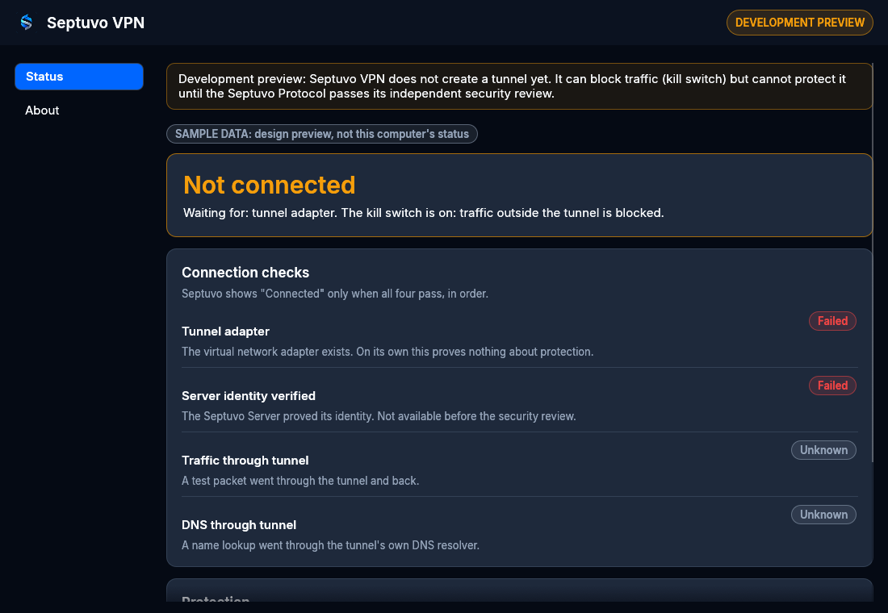
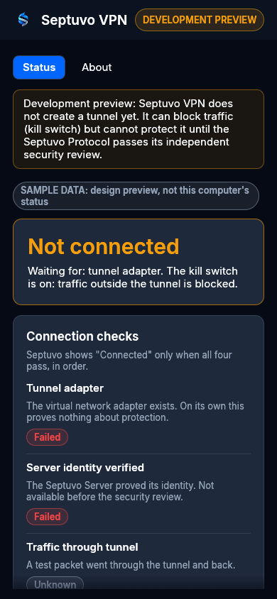
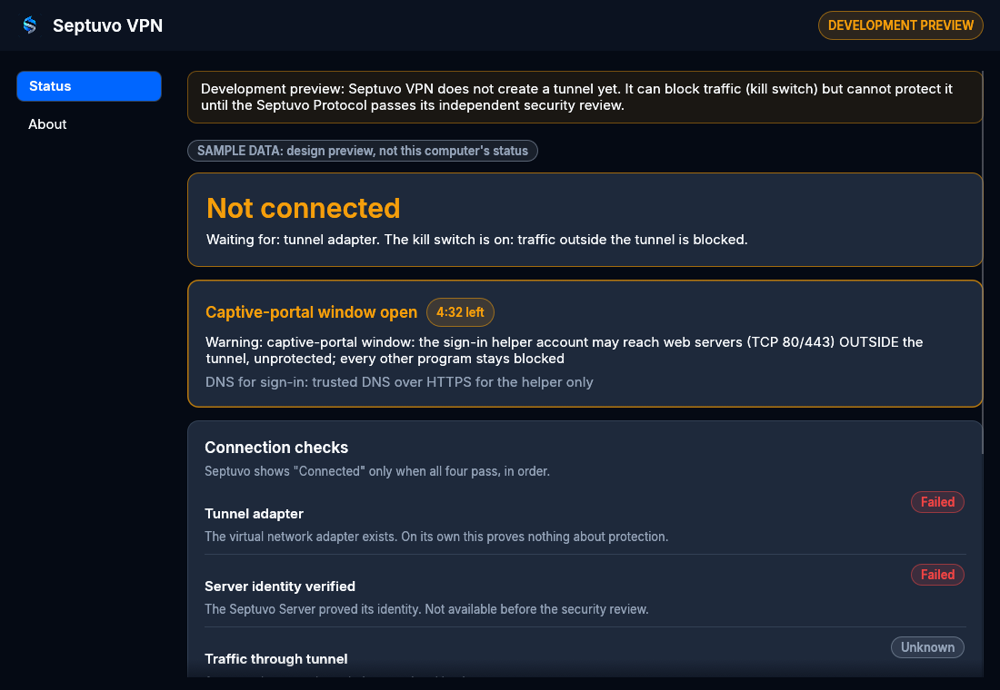
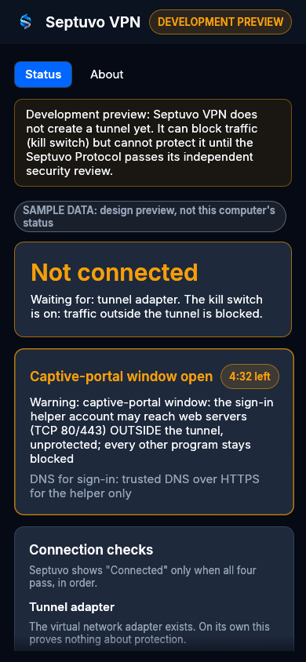
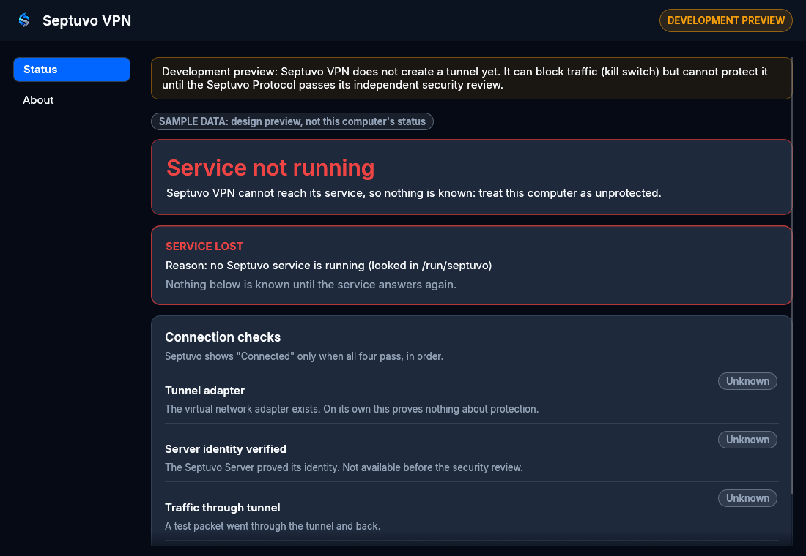
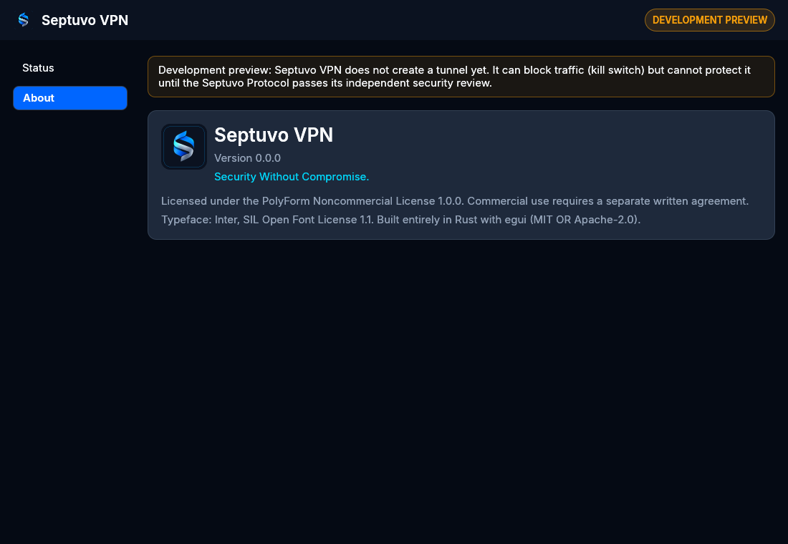
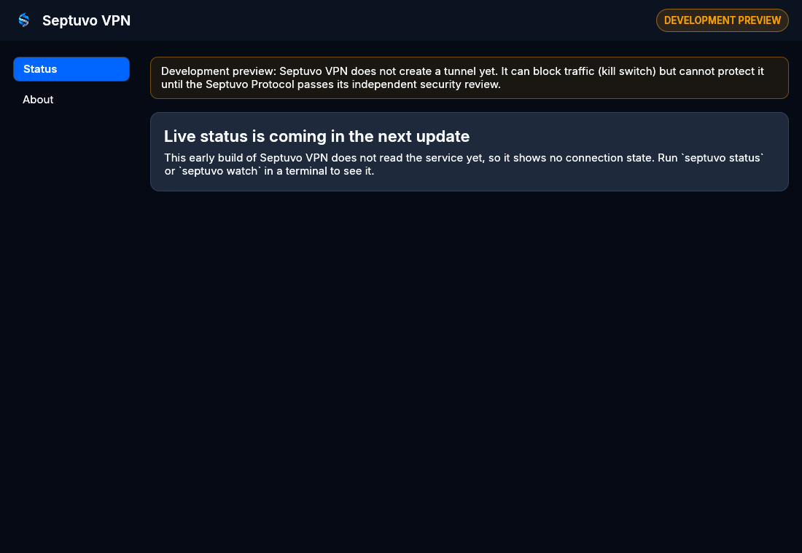

# Septuvo VPN desktop app (Linux, N4)

**Development preview.** The app creates no tunnel and has no cryptography before the G1 security review. It is an unprivileged viewer and remote control for the `septuvod` service, which stays lab-only (N3-01).

- **Code:** `desktop/`, a separate Cargo workspace (N4-D4), PolyForm Noncommercial 1.0.0 (N4-D5).
- **Language:** all Septuvo-authored code is Rust (D-005).
- **Toolkit:** egui/eframe 0.36.2 with the OpenGL (glow) renderer and AccessKit screen-reader support (N4-D1).
- **Dependencies:** reviewed in [dependency-review-desktop.md](../reviews/dependency-review-desktop.md), pinned in `desktop/Cargo.lock`, and checked in CI by the native-code gate.

## What N4-01 delivers

| Part | Where | Notes |
| --- | --- | --- |
| Window, theme, header, navigation | `desktop/src/app.rs`, `pages.rs`, `theme.rs` | Brand tokens and the Inter typeface. Navigation moves from the side to the top below 720 px; usable from 360 px wide |
| Status page **prototype** | `desktop/src/pages.rs` (drawing), `view.rs` (view model) | Not yet connected to the service: the app says so instead of showing a state it has not checked. **N4-02** wires in live status |
| About page | `desktop/src/pages.rs` | Version, tagline, licence, typeface credit |
| View model | `desktop/src/view.rs` | Plain Rust, built from one service answer. "Connected" only when all four checks pass (shared model, D-020). Untrusted text is shown as plain text, without control characters, and length-bounded |
| Refuses root | `desktop/src/lib.rs` (`check_user`) | Exits with status 2 and an explanation. The service does the privileged work |
| Design preview | `desktop/examples/preview.rs` | Shows the styled pages with **sample data** (labelled on screen) and can save a screenshot. Development only: never part of `septuvo-vpn` |
| Native-code gate | `crates/septuvo-native-gate`, `desktop/native-allowlist.txt` | See below |

## Design preview (for the owner's approval)

Rendered in CI and locally with Mesa's software OpenGL. **Sample data**, not a real computer's status:

| Wide (1100 × 760) | Narrow (390 × 844) |
| --- | --- |
|  |  |
|  |  |
|  | |
|  | |
|  | |

## Build and run

From `desktop/`:

```sh
cargo build --locked --release
target/release/septuvo-vpn            # as your normal user, never as root
```

**Design preview with sample data:**

```sh
cargo run --locked --example preview -- captive
cargo run --locked --example preview -- lost --size 390x844 --screenshot lost.png
```

States: `disconnected`, `blocking`, `captive`, `lost`, `pending`, `about`.

**Requirements on the machine:** a Wayland or X11 desktop with OpenGL (Mesa provides software OpenGL without a GPU) and `libxkbcommon`. These are operating-system libraries, loaded at run time.

## Tests

```sh
cargo test --locked          # from desktop/
```

- **View model** (`src/view.rs`): every state, including all 81 combinations of the four checks, the lost service, the captive window and untrusted text.
- **UI through the accessibility tree** (`tests/ui.rs`, `egui_kittest`): what a screen reader would announce, on wide and narrow windows. It covers:
  - the preview notice;
  - "Not connected" and never "Connected";
  - the service-lost warning;
  - the captive-portal warning;
  - navigation by accessible label;
  - the logo's alt text.
- **Theme** (`src/theme.rs`): text colours meet WCAG AA contrast (4.5:1) on every background they are drawn on.

## The native-code gate (D-005, D-015)

Septuvo-authored code is Rust. External components may be in any language, but each is reviewed before it is adopted. The gate makes that mechanical for `desktop/`.

```sh
# from the repository root
cargo run --locked -p septuvo-native-gate -- deps --manifest-path desktop/Cargo.toml --allowlist desktop/native-allowlist.txt
cargo run --locked -p septuvo-native-gate -- artifacts --allowlist desktop/native-allowlist.txt \
    --target-dir desktop/target desktop/target/release/septuvo-vpn
```

**`deps` inspects every crate cargo builds for Linux.** That includes normal, build and dev dependencies, with the features actually enabled (`cargo metadata` and `cargo tree`, both `--locked`). It fails on:
- a native build tool (`cc`, `cmake`, `pkg-config`, `bindgen`…) not shown to be inert for the enabled features;
- a build script that runs a compiler;
- a `links` key;
- a library linked or loaded at run time;
- a bundled binary;
- a stale allowlist entry.

Each of these passes only if `desktop/native-allowlist.txt` lists it with a reason. **GTK, libadwaita, Qt, Skia, web-view and SDL crates always fail**, because N4-D1 excludes them.

**`artifacts` checks after a real build.** The build directory must hold no native objects compiled by build scripts, and the binary may need only listed libraries (its ELF `DT_NEEDED` entries, read in Rust).

**Tests** (`crates/septuvo-native-gate/tests/gate.rs`) build throw-away workspaces:
- a pure-Rust one passes;
- one with a crate that compiles C in its build script fails on its `links` key, its build tool, the compiler and archiver it runs, and the library it links;
- after a real build of the C fixture, `artifacts` finds the compiled object.

Changing the allowlist is a dependency decision (D-015): it needs the owner's approval in a pull request.

## CI

`.github/workflows/desktop.yml`, Ubuntu 24.04 with the pinned toolchain, runs in order:
1. the native-code gate (`deps`);
2. `cargo fmt --check` and `clippy -D warnings`;
3. tests;
4. a release build and the native-code gate (`artifacts`);
5. the root-refusal check (`sudo septuvo-vpn` must exit 2);
6. a headless start-up under Xvfb with Mesa software OpenGL (still running after 10 s);
7. the design-preview screenshots, uploaded as the `desktop-design-preview` artifact.

Xvfb, Mesa and the X11/Wayland/keyboard libraries are Ubuntu packages installed on the runner only, to run the tests.
